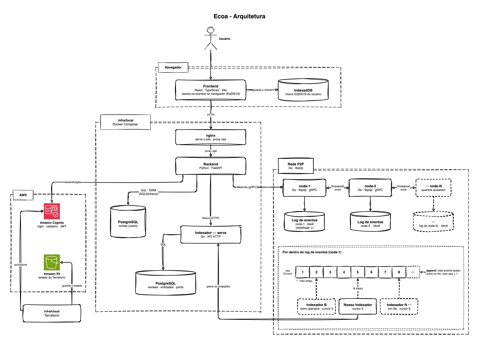

<picture>
  <source media="(prefers-color-scheme: dark)" srcset="brand/banner/ecoa-banner-dark.png">
  
</picture>

# Ecoa

Every experience leaves an echo.

Ecoa is a decentralized network for publishing and reading reviews of
companies, products and services. A review is not a row in someone's
database: it is an event signed on the author's device with an Ed25519 key
that never leaves it. Nodes store and relay the events over libp2p, and no
server, operator or admin can edit or delete one without the change showing.

What a reader sees comes from an indexer, a projection of the events that can
be dropped and rebuilt from the nodes' logs. On day one the project runs every
piece; the design lets anyone run another node, indexer, gateway or client
without losing identity or history. No blockchain, no token.
[Overview](docs/overview.md) says why, and [Concepts](docs/concepts.md)
explains the ideas in plain terms.

## How it fits together

```
frontend ──▶ backend (gateway) ──▶ node ◀──▶ node ◀──▶ node    libp2p: Gossipsub + sync
 signs           │                  │
 locally         │ reads            │ gRPC SubscribeEvents
                 ▼                  ▼
              indexer ◀──────── follows the logs, projects them into Postgres
```

Writes go through a node and out to the network; reads never touch a node.
The client signs, the gateway only passes the signed event on, and every read
answer carries the whole signed envelope so the client can check it.



[Architecture](docs/architecture.md) describes each role, and
[How It Fits Together](docs/diagrams/diagrams.md) draws the flows.

## Repository

| Path | What it is | Stack |
|---|---|---|
| [`protocol/`](protocol/) | The contract every implementation agrees on: JSON Schemas, test vectors, fixtures, and the Go library the services share | JSON Schema · Go |
| [`protobuf/`](protobuf/) | The gRPC contracts: node ↔ gateway and indexer, node ↔ node sync | Protocol Buffers |
| [`node/`](node/) | Validates, stores and relays events; the real network participant | Go · libp2p · bbolt · gRPC |
| [`indexer/`](indexer/) | Follows the nodes' logs, projects them into tables, answers the read API | Go · Postgres · sqlc · goose |
| [`backend/`](backend/) | The gateway: accounts, publishing to a node, reads from the indexer | Python · FastAPI · Postgres · Cognito |
| [`frontend/`](frontend/) | The web client; holds the key and signs in the browser | React · TypeScript · Vite · Tailwind |
| [`infra/local/`](infra/local/) | The whole project on one machine: Postgres, three nodes, indexer, backend, frontend | Docker Compose |
| [`infra/cloud/`](infra/cloud/) | The AWS resources behind the platform (Cognito) | Terraform · LocalStack |
| [`docs/`](docs/) | The design: protocol, identity, entities, reputation, MVP, roadmap, decisions | — |
| [`brand/`](brand/) | Logo, banner, favicons and the [guidelines](brand/guidelines.md) | — |

Each service has its own README with how to run, configure and test it.

## Running it locally

With Docker (Compose v2.24 or later) and `backend/.env` filled in, Cognito
included (see [`backend/.env.example`](backend/.env.example)):

```bash
cd infra/local
docker compose up -d --build
```

Then open <http://localhost:8080>. That starts Postgres, three peered nodes,
the indexer, the backend and the frontend behind nginx.
[`infra/local/README.md`](infra/local/README.md) has the ports, the data
folders and how to start a service over.

To work on one service, run only what it needs from Compose and the service
itself from its folder, as its README shows.

## Status

Building the MVP ([scope and acceptance criteria](docs/mvp.md)), in the order
of the [roadmap](docs/roadmap.md):

| Step | State |
|---|---|
| 0–1. Decisions, schemas, vectors, fixtures | Done |
| 2. Core library (`protocol/go`) | Done |
| 3–4. Node: storage, validation, libp2p, sync | Done; three nodes run locally |
| 5. Indexer | Projects every v1 event type and serves the read API; `rebuild` and the entity summary are next ([what remains](indexer/docs/roadmap.md#what-remains-for-the-mvp-indexer)) |
| 6. Gateway | Accounts, publishing and every read route; rate limiting is pending |
| 7. Client | In progress: accounts, writing and signing a review, browsing |
| 8–11. Domain verification, seeding, social features, self-hosting | Not started |

## Docs

- [Overview](docs/overview.md) — what this is and why
- [Concepts](docs/concepts.md) — the ideas behind it, in plain terms
- [Architecture](docs/architecture.md) — component roles and how they talk to each other
- [How It Fits Together](docs/diagrams/diagrams.md) — the same thing as diagrams, for the flows that are hard to read as prose
- [Protocol](docs/protocol.md) — event format, signing, sync
- [Entities](docs/entities.md) — what's being reviewed, and who can edit it
- [Identity, Trust & Security](docs/identity.md) — keys, verification, threat model
- [Verification](docs/verification.md) — how claims get issued, and why forging one doesn't help
- [Reputation & Ranking](docs/reputation.md) — community voting, weighting, anti-brigading
- [MVP](docs/mvp.md) — v1 scope, acceptance criteria, the demonstration
- [Roadmap](docs/roadmap.md) — what to build, in what order, and why that order
- [Related work](docs/related-work.md) — Nostr, AT Protocol, SSB and ActivityPub, and where this project sits
- [Decision log](docs/decisions.md) — every architectural decision taken in review, with its cost and what was rejected

## Artifacts

- [`protocol/schemas/`](protocol/schemas/) — JSON Schema for the envelope and all 18 event types, transcribed from the specification
- [`protocol/vectors/`](protocol/vectors/) — canonicalization, rejection and ZIP-215 signature test vectors
- [`protocol/fixtures/`](protocol/fixtures/) — behavioural cases for the rules that are easy to implement subtly differently
- [`protocol/go/`](protocol/go/) — the protocol as a Go library, with no network and no storage
- [`protobuf/`](protobuf/) — the gRPC contracts between the services and between nodes
